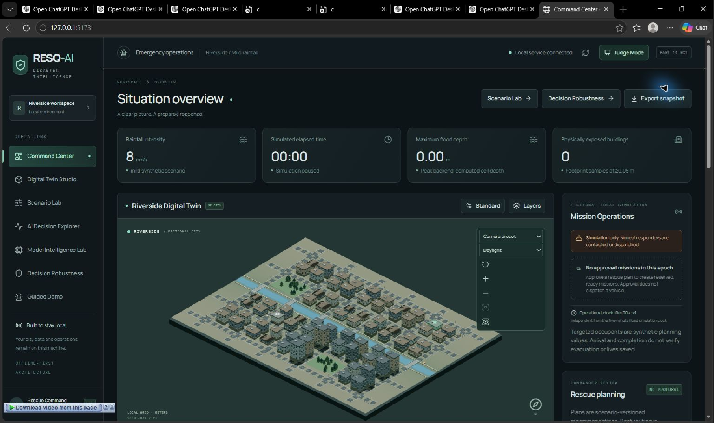
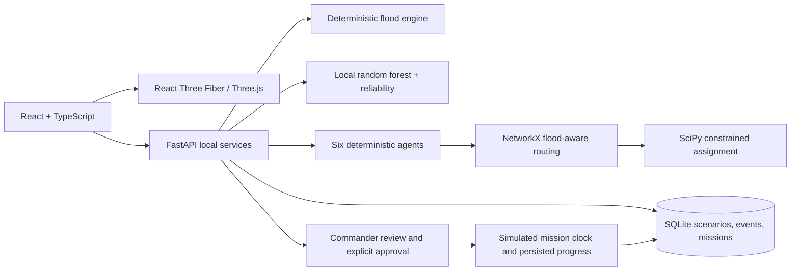

# RESQ-AI

**An offline-first, synthetic disaster decision-support prototype with a flood Digital Twin, local ML, route-aware rescue planning, and human-controlled simulated missions.**

RESQ-AI explores how a response team could inspect changing flood conditions, compare modeled future exposure, coordinate deterministic analysis agents, and review feasible rescue plans in one interface. It is a student engineering and Innotech hackathon project—not a certified emergency system, operational forecast, or replacement for field judgment.



## Try the local demo

The fastest supported setup is Windows PowerShell with Python 3.12 and Node.js 22.12 or newer:

```powershell
.\scripts\setup-resq-ai.ps1
.\scripts\start-resq-ai.ps1
```

Open **http://127.0.0.1:5173**. The launcher checks local dependencies and model artifacts, waits for backend health, then starts the frontend. Press Ctrl+C in the launcher terminal to stop the services. See [Local Demo Quickstart](docs/LOCAL_DEMO_QUICKSTART.md) and [Demo Preflight](docs/DEMO_PREFLIGHT.md).

The application works locally after dependencies are installed. No hosted inference API, external map service, or credentials are needed for the core demo.

## Five-Minute product walkthrough

1. Show the 3D Riverside city and step the deterministic flood simulation.
2. Compare authoritative physical exposure with the locally trained model's future exposure estimate and reliability/support warnings.
3. Inspect the six deterministic agent decisions and their persisted trace.
4. Review route-feasible, priority-weighted assignments against a conventional baseline.
5. Explicitly approve simulated missions, dispatch units, and observe backend-authoritative progress.
6. Demonstrate an honest failure case: when all modeled roads are closed, the router returns no supported ground assignment. It does not invent a route.

Use the exact timed script in [Innotech Five-Minute Presentation](docs/INNOTECH_5_MINUTE_PRESENTATION.md). For a presentation rehearsal, follow the disposable setup and recovery guidance in [Demo Fallback and Recovery](docs/DEMO_FALLBACK_AND_RECOVERY.md).

## What is implemented

- Deterministic flood simulation, scenario persistence, checkpoints, and replay.
- Procedural 3D city and infrastructure rendering with flood and route overlays.
- A locally trained random forest for a synthetic future-exposure target, plus calibration and training-support warnings.
- Six event-driven **algorithmic** agents with durable decision traces; they are not language-model agents.
- Flood-aware NetworkX road routing and SciPy constrained resource assignment with a transparent baseline comparison.
- Human approval before simulated mission creation, explicit dispatch, persisted route progress, blockage/review, arrival/completion, and explicit return-to-service.
- Scenario A/B experiments and isolated Decision Robustness Lab counterfactuals.
- Judge Mode, Guided Demo, local preflight and disposable acceptance workflows.

See the [architecture overview](docs/RESQ_AI_ARCHITECTURE_OVERVIEW.md) for editable Mermaid diagrams and system boundaries.

## Evidence and research

Part 15 adds a reproducible ten-group synthetic evaluation with JSON/CSV/Markdown output, a model reliability plot, a genuine local-browser screenshot gallery, and a complete Innotech/portfolio documentation set.

```powershell
.\backend\.venv\Scripts\python.exe .\backend\run_part15_evaluation.py
```

The historical Part 15 run took 3,768.693 ms. The Part 16 release-hardening rerun took **2,245.968 ms** across ten groups: the optimized priority objective improved in 8 groups, tied within the symmetric ±0.01 tolerance in 2, and was lower in 0. Two groups had zero assignments; the all-roads-closed case correctly produced zero. The regenerated evidence is in [Scientific Evaluation](docs/SCIENTIFIC_EVALUATION.md) and the per-case [CSV](docs/evidence/part15/scientific_evaluation.csv). Results are synthetic, configuration-specific measurements, not real-world rescue-effectiveness claims.

The ML dataset contains 72 synthetic scenario groups (42 train, 15 validation, 15 untouched test); each prediction horizon covers six future five-minute ticks. Grouped validation keeps correlated steps from one scenario together. Platt calibration was adopted through a nested grouped development gate. The untouched synthetic test Brier score was 0.030526 raw and 0.027917 calibrated; log loss was 0.106666 raw and 0.094190 calibrated. This is not calibration against real disaster outcomes. Details and reliability plots are linked in [Scientific Evaluation](docs/SCIENTIFIC_EVALUATION.md) and the [model card](docs/ML_RELIABILITY_MODEL_CARD.md).

## Architecture



See the full data-flow, mission state-machine, decision-boundary, and counterfactual-isolation diagrams in [RESQ-AI Architecture Overview](docs/RESQ_AI_ARCHITECTURE_OVERVIEW.md).

## Evaluation and local checks

From the repository root, using the installed local environment:

```powershell
.\backend\.venv\Scripts\python.exe -m pytest --basetemp=.pytest-tmp-part15
Push-Location frontend
npm test -- --reporter=dot
npm run lint
npm run typecheck
npm run generate-api
npm run build
Pop-Location
```

The backend also exposes `backend/export_contract.py`. Disposable Part 10/14 acceptance workflows, preflight checks, and the robustness benchmark are documented in [Part 15 Verification](docs/PART_15_VERIFICATION.md). Build output has previously reported a large lazy CityScene chunk; consult the current verification run before treating any size or timing as current.

## Engineering case study and presentation kit

See the [Part 16 release checklist](docs/FINAL_RELEASE_CHECKLIST.md), [verification matrix](docs/PART_16_VERIFICATION.md), and [submission kit](docs/INNOTECH_SUBMISSION_KIT.md) for the current candidate handoff status.

- [Portfolio Case Study](docs/RESQ_AI_PORTFOLIO_CASE_STUDY.md)
- [90-Second Pitch](docs/INNOTECH_90_SECOND_PITCH.md)
- [Five-Minute Presentation](docs/INNOTECH_5_MINUTE_PRESENTATION.md)
- [Slide Storyboard](docs/INNOTECH_SLIDE_STORYBOARD.md)
- [Judge Q&A](docs/INNOTECH_JUDGE_QA.md)
- [Technical Deep Dive](docs/INNOTECH_TECHNICAL_DEEP_DIVE.md)
- [Visual Evidence Gallery](docs/VISUAL_EVIDENCE_GALLERY.md)
- [Demo Fallback and Recovery](docs/DEMO_FALLBACK_AND_RECOVERY.md)

## Important boundaries

- Floods, buildings, roads, labels, resources, and outcomes are synthetic. The model is not validated against operational disaster outcomes.
- The road graph represents modeled connectivity and assumptions, not surveyed roads or field safety. A feasible graph route is not an emergency access guarantee.
- The optimizer solves its encoded assignment objective and constraints; it cannot guarantee a globally best real-world response.
- Human approval is required for plan commitment. Dispatch, travel, arrival, completion, and return-to-service are simulated actions, not contact with real responders.
- Unsupported routes stay unreachable. In the all-roads-closed condition, zero assignments is the correct modeled outcome.
- Earthquake simulation, live geospatial feeds, boat routing, real dispatch integrations, and real-world validation are outside the implemented prototype.

## Project record

Part 15 was merged to `main` as commit `156b88dfda55728a3e8ecc3ff23fc5d5826b9ddb` through [PR #15](https://github.com/24f2003970/RESQ-AI/pull/15). Its final head run [39045759422](https://github.com/24f2003970/RESQ-AI/actions/runs/39045759422) passed backend and frontend jobs. Part 16 release hardening is under review in [PR #16](https://github.com/24f2003970/RESQ-AI/pull/16) on `feature/part-16-final-release`; it remains open and unmerged. No public release or deployment is implied.
