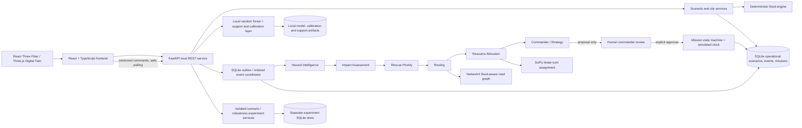
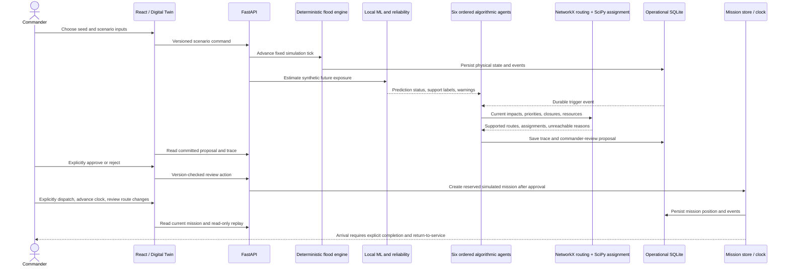
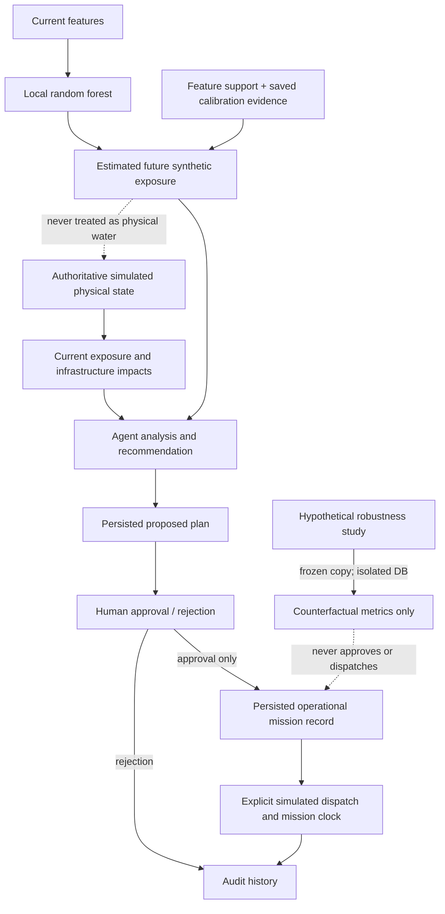
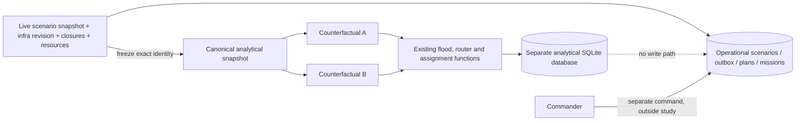

# RESQ-AI architecture overview

Editable Mermaid sources below reflect the implementation through Part 15. Part 15 adds evaluation and evidence tooling without changing the application's operational architecture. Diagrams describe local software boundaries and the deterministic synthetic prototype.

## System architecture



The agents are deterministic algorithmic services. They are not language-model agents. The frontend displays backend truth and can emit commands; it does not calculate authoritative flood depth, model predictions, rescue routes or assignments.

## End-to-end flow



## Mission state machine

```mermaid
stateDiagram-v2
  [*] --> ready: approved plan creates reserved mission
  ready --> en_route: explicit dispatch
  ready --> cancelled: explicit cancellation / reservation released
  en_route --> blocked: closure intersects an untraversed route edge
  en_route --> arrived: authoritative mission clock reaches destination
  en_route --> cancelled: explicit cancellation / unit unavailable
  blocked --> en_route: route revision proposed and explicitly approved
  blocked --> cancelled: explicit cancellation / unit unavailable
  arrived --> completed: explicit simulated completion
  arrived --> cancelled: explicit cancellation / unit unavailable
  completed --> [*]
  cancelled --> [*]
  note right of completed: Resource remains unavailable until explicit return-to-service.
  note right of cancelled: A ready-mission cancellation releases its reservation; dispatched cancellation requires explicit return-to-service.
  note right of en_route: Pause / resume changes the scenario mission clock; it is not a mission status.
```

Arrival and completion do not verify evacuation or lives saved. No return journey is fabricated. Reset begins a new scenario epoch and retains history from the old epoch.

## Reliability and decision boundaries



Physical exposure comes from the flood engine. Future exposure is an estimate from a model trained on synthetic simulator outputs and can carry unavailable, unsupported or edge-of-support warnings. A plan is a proposal until a commander approves it. Robustness results are hypothetical; they do not change live plans, closures, reservations or missions.

## Counterfactual isolation



See [Part 10 implementation](PART_10_IMPLEMENTATION.md), [agent architecture](AGENT_ARCHITECTURE.md), [routing model](ROUTING_MODEL.md), [mission lifecycle](MISSION_LIFECYCLE.md), and [counterfactual evaluation](COUNTERFACTUAL_EVALUATION.md) for source-level contracts.
